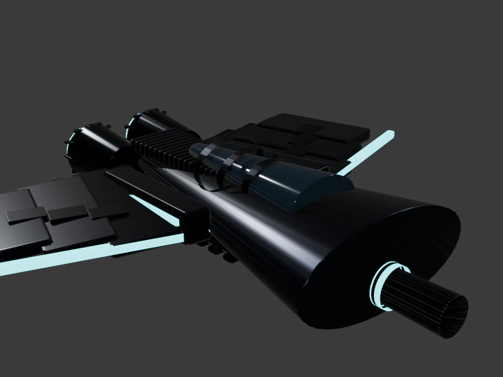
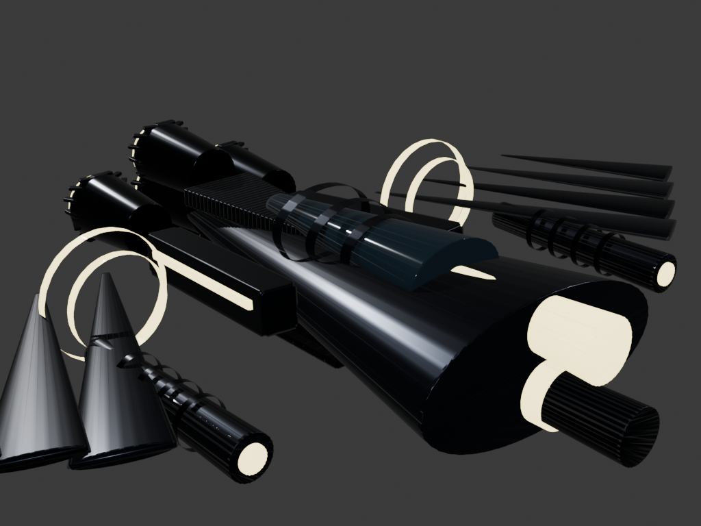
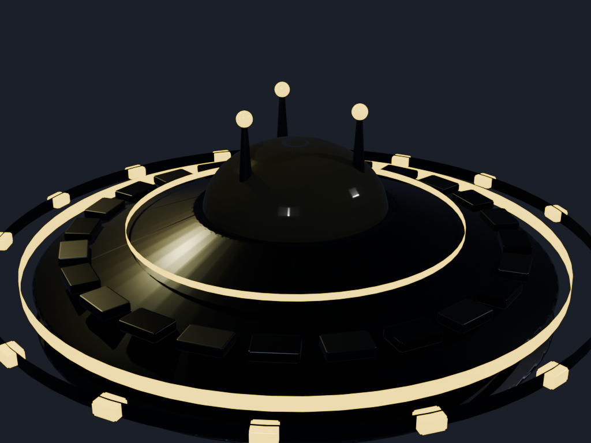
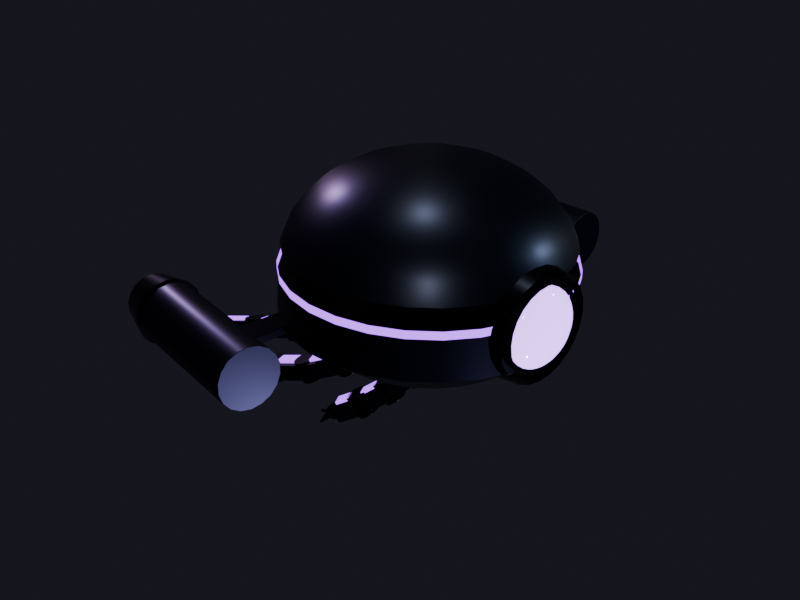
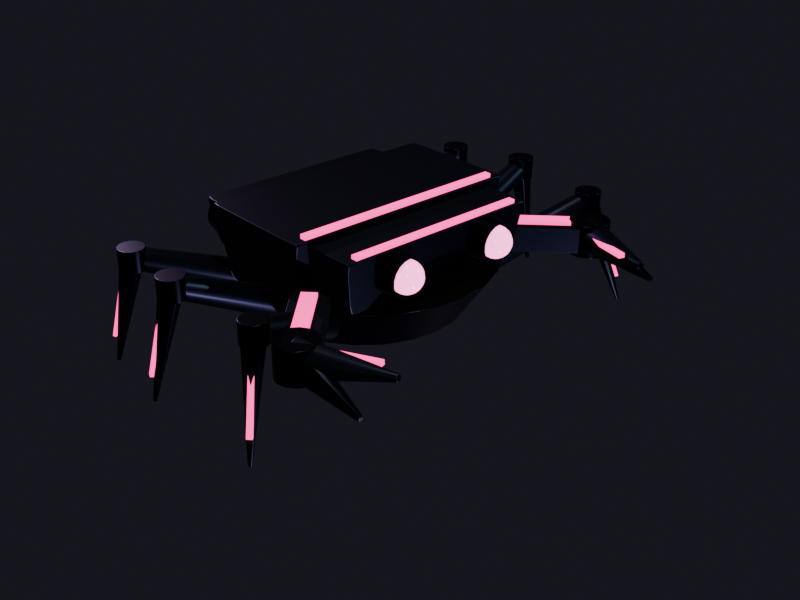
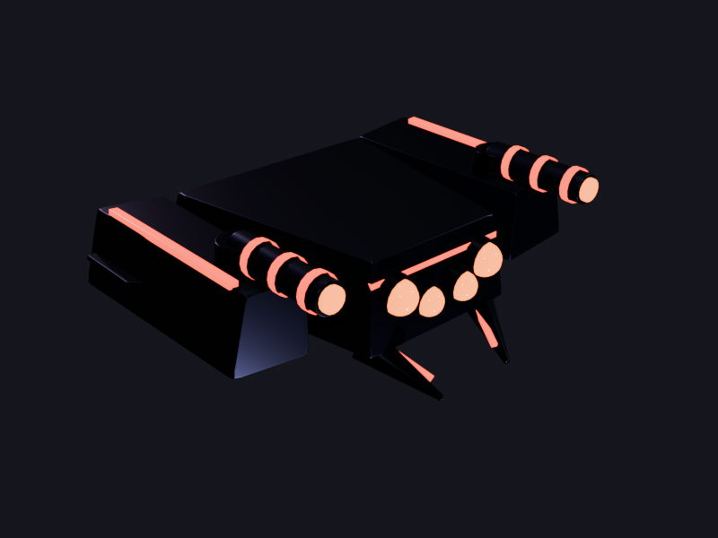
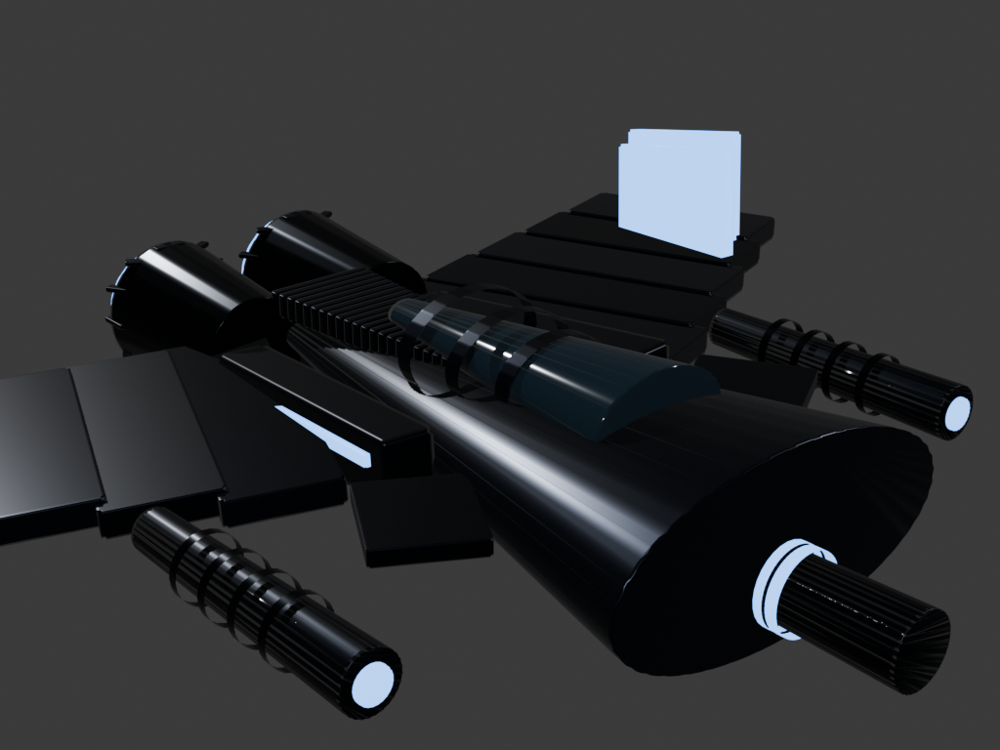
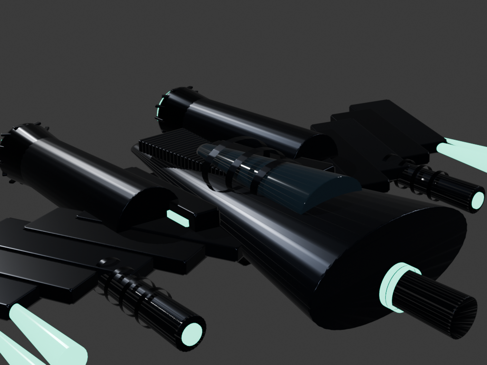
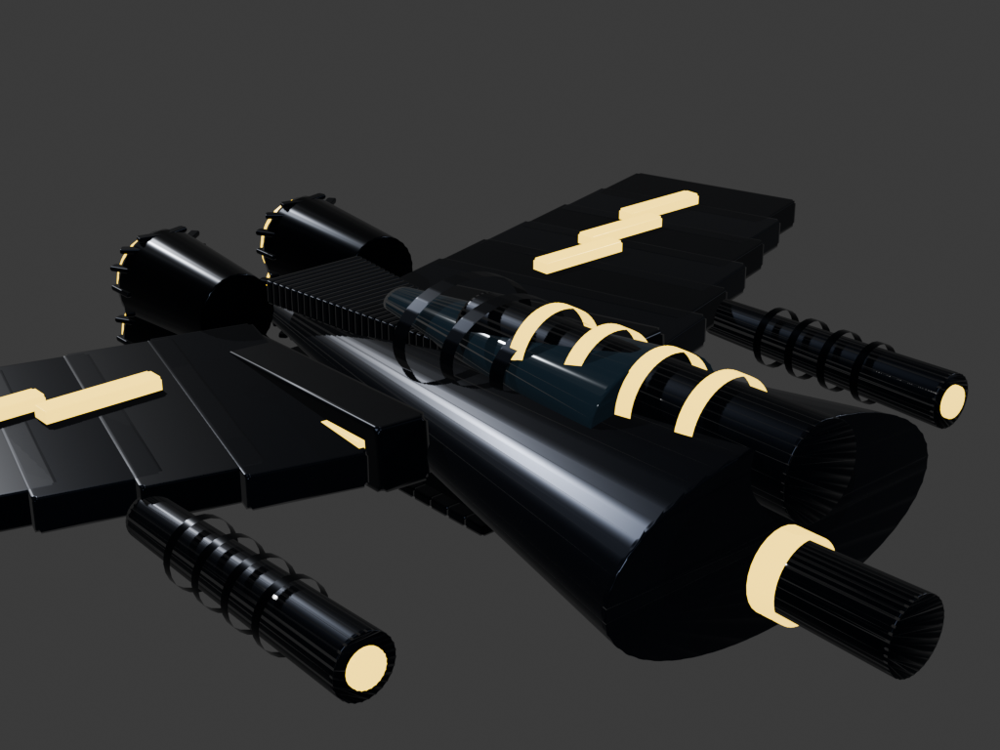
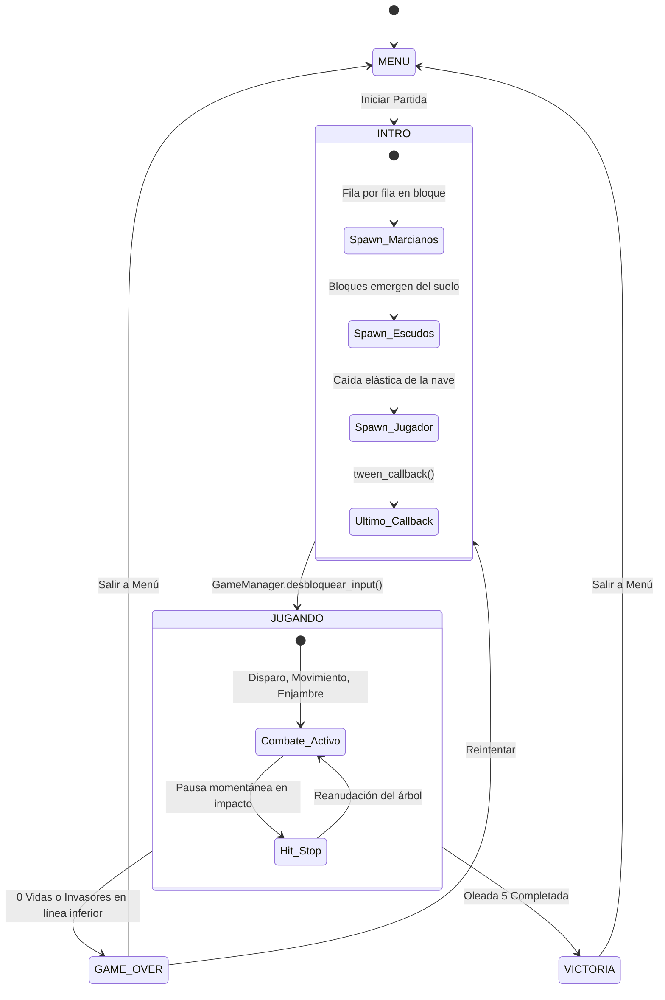

<div align="center">

# 👾 Space Invaders 3D — Edición Arcade Neón

**Videojuego Arcade 3D desarrollado en Godot 4 + Blender con enfoque en Animación Procedural, Game Feel y Micro-interacciones Sensoriales**

[](https://godotengine.org/)
[](https://www.blender.org/)
[](#arquitectura-del-proyecto)
[](#pipeline-3d-en-blender)

<p align="center">
  
  
  
</p>

</div>

---

## 📖 Descripción General

**Space Invaders 3D — Edición Arcade Neón** reinventa el clásico arcade espacial en un entorno tridimensional con estética neón (Tonemap ACES, Glow y Bloom), modelos **High Poly** creados y animados en **Blender**, efectos de sonido retro de 16-bit y un sistema integral de **Game Feel** construido con `Tween` y `AnimationPlayer` en **Godot 4**.

El proyecto desacopla la física (`Area3D`) de la representación visual (`Node3D` intermedio + mallas `.glb`), permitiendo combinar animaciones internas exportadas desde Blender (`Idle-loop`, `Spawn`) con transformaciones elásticas en tiempo real controladas por código.

---

## 🎮 Controles y Atajos

### Controles del Jugador
| Acción | Teclas / Entrada |
| :--- | :--- |
| **Mover a la izquierda** | `Flecha Izquierda` o tecla `A` |
| **Mover a la derecha** | `Flecha Derecha` o tecla `D` |
| **Disparar láser** | `Barra Espaciadora` (`Space`) |
| **Pausa / Menú** | Botón interactivo en pantalla (HUD) |

### 🛠️ Teclas de Depuración (Debug Keys)
| Tecla | Función de Prueba |
| :--- | :--- |
| `F1` – `F5` | Saltar directamente a la oleada **1, 2, 3, 4 o 5** (actualiza automáticamente la evolución de la nave). |
| `F9` | Forzar pantalla de **¡Victoria!** con animaciones elásticas (`TRANS_ELASTIC`). |
| `F10` | Forzar pantalla de **Game Over** con animaciones elásticas. |
| `F11` | Destruir a todos los invasores activos para probar transiciones de nivel inmediatas. |

---

## ✨ Características Principales y Game Feel

1. **Secuencia Coreografiada de Entrada (`INTRO`)**:
   - Orden estricto sincronizado con corrutinas (`await`): **Marcianos ➔ Escudos ➔ Jugador**.
   - **Enjambre enemigo:** Desciende rítmicamente fila por fila en bloque usando curvas `TRANS_BACK` y `TRANS_CUBIC`.
   - **Búnkeres defensivos:** Emergen del suelo en oleada escalonada.
   - **Nave del jugador:** Cae con rebote elástico (`TRANS_ELASTIC` / `TRANS_BOUNCE`) y **desbloquea el input del jugador únicamente en el callback final** de la animación.
2. **Feedback de Combate y Eliminación 3D**:
   - **Hit-Stop con concurrencia segura:** Congelación momentánea de `0.06s` al destruir invasores y `0.12s` al recibir daño, gestionada mediante contador de congelaciones sobre `get_tree().paused` para evitar cancelaciones prematuras en impactos simultáneos.
   - **Prevención de doble impacto:** Desactivación diferida inmediata del `CollisionShape3D` (`set_deferred("disabled", true)`).
   - **Vórtice de aniquilación 3D:** Contracción a escala `0.001` (`TRANS_BACK` + `EASE_IN`) combinada en paralelo con rotación de $360^\circ$ (`TAU`) sobre el eje Y en `0.4s` antes de liberar memoria con `queue_free()`.
3. **Evolución Dinámica de la Nave del Jugador**:
   - Cada 2 oleadas completadas, la nave evoluciona automáticamente cargando un nuevo modelo 3D (`nave_mk1.glb` hasta `nave_mk5.glb` y rovers especiales en niveles avanzados).
4. **Micro-interacciones Sensoriales**:
   - Destello de impacto y telegrafía visual antes del disparo enemigo.
   - Explosiones de partículas con el color de acento neón de cada clase de invasor.
   - Sacudida de cámara armónica amortiguada en 3 ejes (`X, Y, Z`).
   - Destello de cañón (*muzzle flash*) e inclinación dinámica (*banking tilt* en el eje Z) al desplazarse.
   - Etiquetas 3D flotantes de puntaje (`+10`, `+20`, `+30`, `+100`) y efecto *pop* en el HUD.
   - Entorno espacial vivo con planeta rotatorio en segundo plano y campo de estrellas 3D.
5. **Persistencia de Récord (High Score)**:
   - Almacenamiento binario automático en `user://highscore.save` actualizado en tiempo real al superar la marca máxima.

---

## 🎨 Galería de Modelos 3D (Blender ➔ Godot)

<div align="center">
  <table>
    <tr>
      <td align="center"><br/><b>Enemigo A «Calamar»</b><br/><sub>Fila 1 · 30 PTS · #FF1AD9</sub></td>
      <td align="center"><br/><b>Enemigo B «Cangrejo»</b><br/><sub>Filas 2–3 · 20 PTS · #00F2FF</sub></td>
      <td align="center"><br/><b>Enemigo C «Behemoth»</b><br/><sub>Filas 4–5 · 10 PTS · #FFD700</sub></td>
    </tr>
    <tr>
      <td align="center"><br/><b>Nave Mk II «Striker»</b><br/><sub>Niveles 3–4 · #3D7BFF</sub></td>
      <td align="center"><br/><b>Nave Mk III «Phantom»</b><br/><sub>Niveles 5–6 · #00FFB3</sub></td>
      <td align="center"><br/><b>Nave Mk IV «Titan»</b><br/><sub>Niveles 7–8 · #FFB300</sub></td>
    </tr>
  </table>
</div>

---

## 🏗️ Arquitectura del Proyecto

### Flujo de Estados del Juego (`GameManager`)



### Estructura de Carpetas

```text
space_invaders_3d/
├── autoload/                  # Singletons globales (Autoloads)
│   ├── game_manager.gd        # Máquina de estados, vidas, oleadas, bloqueo de input y High Score
│   └── game_feel.gd           # Hit-Stop concurrente y señal global de sacudida de cámara
├── scenes/                    # Escenas de Godot (.tscn)
│   ├── main.tscn              # Escena principal, iluminación, cámara 3D y entorno espacial
│   ├── hud.tscn               # Interfaz Arcade Neón, menús y pantallas finales elásticas
│   ├── player.tscn            # Nave del jugador con soporte multi-modelo
│   ├── invader_fleet.tscn     # Controlador del enjambre (5 filas × 11 columnas)
│   ├── invader.tscn           # Actor enemigo individual (Tipos A, B y C)
│   ├── bunker.tscn            # Escudos defensivos destructibles por bloques
│   ├── ufo.tscn               # Ovni nodriza de bonificación
│   └── laser.tscn             # Proyectiles del jugador y enemigos
├── scripts/                   # Lógica de comportamiento en GDScript (.gd)
├── assets/
│   ├── audio/                 # Efectos de sonido retro (.wav)
│   └── models/                # Modelos 3D exportados en formato glTF 2.0 (.glb)
├── blender/                   # Pipeline de creación 3D en Blender
│   ├── src/                   # Archivos fuente nativos de Blender (.blend)
│   ├── scripts/               # Scripts de Python (bpy) para generación y renderizado
│   └── renders/               # Renders de vista frontal, cenital, isométrica y hero (.png)
└── docs/                      # Documentación técnica detallada
```

### Patrón de Jerarquía de Nodos (Desacoplamiento Física / Visual)

```text
Actor (Area3D)                  ← Posición global en el mundo, física y señales
├── CollisionShape3D            ← Caja/esfera de colisión (se desactiva al morir)
└── Visual (Node3D)             ← Pivote exclusivo para Tweens (escala, giro Y, inclinación Z)
    └── Model (.glb)            ← Malla importada de Blender con su propio AnimationPlayer
```

---

## 🔧 Pipeline 3D en Blender

En la carpeta [`blender/`](blender/) se encuentran tanto los archivos originales `.blend` como los scripts de automatización en Python (`bpy`) utilizados para construir, animar, exportar a `.glb` y renderizar el catálogo de modelos:

- **Archivos fuente (`blender/src/`):** `nave_mk1.blend` a `nave_mk5.blend`, `enemigo_a.blend`, `enemigo_b.blend`, `enemigo_c.blend`, `ovni_bonus.blend`, `escudo.blend`, `proyectiles.blend` y `planeta_fondo.blend`.
- **Scripts de construcción (`blender/scripts/`):** Generación paramétrica de geometría High Poly, materiales emisivos neón y clips de animación (`Idle-loop`, `Spawn`).

---

## 🚀 Cómo Ejecutar el Proyecto

1. **Requisitos previos:**
   - Tener instalado **Godot Engine 4.x** (configurado con renderizador `Forward Plus`, versión recomendada **Godot 4.3+** / **4.7**).
   - *(Opcional)* **Blender 4.x** si deseas inspeccionar o modificar los archivos `.blend` dentro de `blender/src/`.
2. **Clonar el repositorio:**
   ```bash
   git clone https://github.com/Santapec27/space-invaders-3d.git
   ```
3. **Abrir en Godot:**
   - Abre el **Project Manager** de Godot.
   - Haz clic en **Importar** y selecciona el archivo `project.godot` en la raíz del proyecto.
   - Presiona **`F5`** (o el botón *Play*) para iniciar el juego.

---

## 📚 Documentación Técnica Adicional

Para profundizar en las decisiones de ingeniería, matemáticas de animación y arquitectura del proyecto, consulta la carpeta [`docs/`](docs/):

- 📄 [**Profundización de Código (`docs/profundizacion_de_codigo.md`)**](docs/profundizacion_de_codigo.md): Diagramas de estado, justificación matemática de curvas `Tween`, manejo de concurrencia en el Hit-Stop y preguntas frecuentes de arquitectura.
- 📐 [**Convenciones Técnicas (`docs/CONVENCIONES.md`)**](docs/CONVENCIONES.md): Escala métrica (`1 unidad = 1 metro`), ejes, matriz de capas de colisión y paleta de colores HEX.
- 🗂️ [**Inventario del Sistema (`docs/inventario.md`)**](docs/inventario.md): Detalle de todas las escenas, singletons (`Autoload`), configuración de cámara e iluminación.
- 🧊 [**Manifiesto de Assets 3D (`docs/assets_manifest.md`)**](docs/assets_manifest.md): Catálogo completo de modelos `.glb`, conteo de triángulos y animaciones integradas.
- 📝 [**Bitácora de Desarrollo (`docs/bitacora.md`)**](docs/bitacora.md): Registro cronológico de implementación y resolución de problemas técnicos.
