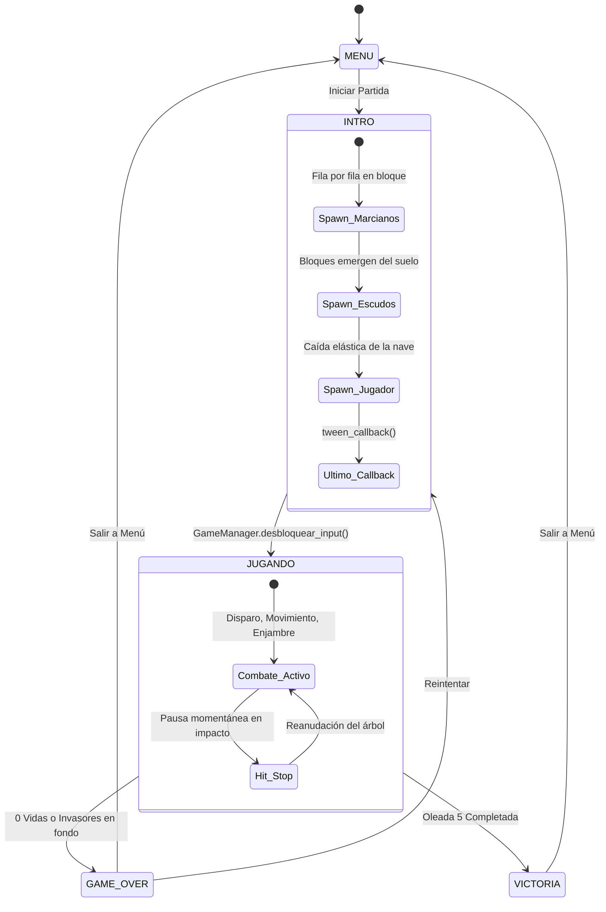

# Profundización de Código — Space Invaders 3D
**Animación Procedural y Game Feel 3D · Godot 4.7 + Blender**
*Documento de arquitectura interna y análisis técnico del código del proyecto*

---

## 1. Control de Flujo del Input durante el Spawn

### Diagrama de Estados (Máquina de Estados Global)



### Explicación Paso a Paso:
1. **Bandera y Estado Global**: Al pulsar "START" en el menú o reiniciar tras Game Over, `MainGame.start_new_game()` invoca:
   ```gdscript
   GameManager.bloquear_input()
   GameManager.cambiar_estado(GameManager.Estado.INTRO)
   ```
2. **Consulta en el Jugador (`player.gd`)**:
   En el método `_process(delta)` de la nave del jugador, la primera instrucción es un guardia estricto:
   ```gdscript
   if GameManager.input_bloqueado or not is_alive:
       return
   ```
   Esto asegura que mientras la intro transcurre, ningún comando de movimiento horizontal ni de disparo sea procesado.
3. **No acumulación de eventos (Anti-Buffer)**:
   A diferencia de almacenar eventos en un buffer de cola, el juego consulta el estado instantáneo de las acciones con `Input.is_action_pressed()`. Si el jugador presiona la barra espaciadora durante el spawn de los marcianos, la pulsación simplemente se ignora y no se genera ningún disparo "fantasma" al iniciar la partida.
4. **Desbloqueo exclusivo en el último callback**:
   El control del juego solo se libera en el callback final de la última animación de la secuencia:
   ```gdscript
   # player.gd -> entrar_en_escena()
   tw.set_parallel(false)
   tw.tween_callback(GameManager.desbloquear_input)
   ```
   Dicha función establece `input_bloqueado = false` y cambia el estado a `Estado.JUGANDO`.

---

## 2. Lógica de Callbacks y Sincronización de Animaciones

### Mecanismos de Detección de Fin de Animación Utilizados:

| Método | Dónde se usa | Acción lógica que dispara |
|---|---|---|
| `await tw.finished` | `invader_fleet.gd` (`spawn_por_filas`) | Detiene la ejecución asíncrona de la función hasta que toda la fila de invasores completa su descenso; reproduce el clip `Idle-loop` y da paso a la siguiente fila. |
| `await tw.finished` | `bunker.gd` (`spawn_escudos`) | Espera a que los bloques de los búnkeres terminen de emerger del suelo antes de llamar a la nave del jugador. |
| `tw.tween_callback(...)` | `player.gd` (`entrar_en_escena`) | Ejecuta `GameManager.desbloquear_input()` exactamente cuando la animación elástica de la nave concluye su asentamiento. |
| `tw.tween_callback(...)` | `invader.gd` (`eliminar_enemigo`) | Ejecuta `_terminar_salida()`, la cual emite la señal `salida_terminada` y llama a `queue_free()`. |

### Manejo de Ciclo de Vida y Seguridad de Nodos (`is_inside_tree`):
Cuando se utilizan corrutinas asíncronas con `await` (como al esperar la finalización de un Hit-Stop de 0.06 segundos), el estado del árbol de escena puede cambiar si el nivel se reinicia o el jugador sale al menú principal.
Por esta razón, en `invader.gd` se verifica preventivamente:
```gdscript
await GameFeel.hit_stop(0.06)
if not is_inside_tree():
    return
```
Esto previene el error clásico `Attempt to call function on a previously freed instance`.

---

## 3. Gestión de la Eliminación (Justificación de Parámetros)

El proceso de eliminación en `invader.gd` cumple el ciclo exacto:
**Desactivación de Colisión ➔ Hit-Stop ➔ Animación 3D ➔ `queue_free()`**

```gdscript
func eliminar_enemigo() -> void:
    if muerto: return
    muerto = true
    
    # 1. Desactivación física inmediata
    collision_shape.set_deferred("disabled", true)
    
    # 2. Señal de puntaje y feedback sensorial
    invader_destroyed.emit(self, score_value)
    GameFeel.sacudir_camara(0.18, 0.15)
    await GameFeel.hit_stop(0.06)
    
    if not is_inside_tree(): return
    
    # 3. Animación 3D combinada en paralelo
    var tw := create_tween().set_parallel(true)
    tw.tween_property(visual, "scale", Vector3.ONE * 0.001, 0.4) \
        .set_trans(Tween.TRANS_BACK).set_ease(Tween.EASE_IN)
    tw.tween_property(visual, "rotation:y", TAU, 0.4).as_relative()
    
    # 4. Callback final que libera memoria
    tw.set_parallel(false)
    tw.tween_callback(_terminar_salida)
```

### Justificación Técnica de cada Parámetro:

1. **Duración de 0.4 segundos**:
   - A 60 FPS representa exactamente 24 fotogramas de transición.
   - Es el punto óptimo entre legibilidad visual (el ojo humano distingue claramente la destrucción) y ritmo arcade (no satura la pantalla con enemigos en agonía ni retrasa el avance de la partida).
2. **`TRANS_BACK` + `EASE_IN`**:
   - La curva matemática `TRANS_BACK` con suavizado `EASE_IN` produce un efecto de **anticipación física**: el modelo se expande ligeramente (como si fuera a estallar) antes de contraerse violentamente hacia el centro.
3. **Rotación relativa de $360^\circ$ (`TAU`) en el eje Y**:
   - Produce un efecto de "vórtice de aniquilación".
   - Al usar `TAU` ($2\pi$ radianes), la rotación completa una vuelta exacta, evitando giros discontinuos.
4. **Desactivación previa de la colisión (`set_deferred("disabled", true)`)**:
   - Evita colisiones redundantes ("double hit"): un láser continuo o un segundo proyectil no pueden impactar a un enemigo que ya está muriendo.
   - Garantiza que la nave del jugador o los escudos no sufran colisión fantasma contra un enemigo en proceso de desaparición.
5. **`queue_free()` en el callback final**:
   - Llamar a `queue_free()` al inicio destruiría la malla antes de poder verse la animación.
   - Dejar el nodo sin `queue_free()` provocaría una fuga de memoria (memory leak) de instancias de nodos huérfanos.

---

## 4. Hit-Stop (Pausa Dinámica de Impacto)

### Funcionamiento Técnico en `autoload/game_feel.gd`:
```gdscript
func hit_stop(duracion: float = 0.06) -> void:
    if GameManager.estado != GameManager.Estado.JUGANDO:
        return
        
    _congelaciones += 1
    get_tree().paused = true
    
    # Temporizador inmune a la pausa del árbol
    await get_tree().create_timer(duracion, true, false, true).timeout
    
    _congelaciones -= 1
    if _congelaciones <= 0:
        _congelaciones = 0
        get_tree().paused = false
```

### ¿Por qué `get_tree().paused` y no `Engine.time_scale` ni `set_process(false)`?
- `Engine.time_scale = 0` altera los deltas de cálculo de físicas y puede generar saltos o errores de túnel en el motor de colisiones de Godot.
- `set_process(false)` requeriría iterar manualmente por decenas de nodos individuales, dejando vulnerables a AnimationPlayers o tweens que seguirían corriendo.
- `get_tree().paused = true` congela atómicamente la física, los procesos y las animaciones de todos los nodos cuyo `process_mode` sea `PAUSABLE`.

### El problema de la concurrencia y el contador `_congelaciones`:
Si dos enemigos son eliminados con 0.02s de diferencia:
- Sin contador: El primer timer terminaría a los 0.06s y despausaría el juego, cancelando prematuramente el impacto del segundo.
- Con el contador `_congelaciones`: Cada impacto incrementa el contador, y el juego solo se reanuda cuando el contador vuelve a cero (`_congelaciones == 0`).

---

## 5. Decisiones de Arquitectura 3D (Blender ➔ Godot)

### Patrón del Nodo Visual:
Para que un modelo 3D coexista con animaciones internas de Blender y Tweens de Godot:
1. El nodo raíz (`Area3D`) maneja física y posiciones espaciales globales.
2. El nodo intermedio `Visual` (`Node3D`) actúa como punto de pivote para Tweens (escalado a 0.001, rotación en Y, banking tilt en Z).
3. La instancia importada de Blender (`Model`) contiene su propio `AnimationPlayer` con sus clips (`Idle-loop`, `Spawn`).

---

## 6. Banco de Preguntas y Respuestas para el Docente

**P1: ¿Por qué usaron `await` en lugar de temporizadores tradicionales (`Timer`)?**
> *R:* `await` permite escribir flujos asíncronos secuenciales legibles de arriba a abajo (`spawn_por_filas` ➔ `spawn_escudos` ➔ `entrar_en_escena`) sin dispersar la lógica en múltiples funciones callback desconectadas.

**P2: ¿Cómo evitaron que las pulsaciones del teclado durante la intro se ejecuten al comenzar el juego?**
> *R:* No almacenamos eventos en buffers. Consultamos el estado activo en cada cuadro en `_process()` mediante `Input.is_action_pressed()`, la cual se ignora si `GameManager.input_bloqueado` está activo.

**P3: ¿Por qué animar el nodo `Visual` y no el nodo raíz `Area3D`?**
> *R:* Modificar la escala de un nodo físico a valores cercanos a cero (`Vector3.ZERO`) causa errores de matriz singular en el motor de físicas de Godot. Al animar el nodo `Visual` desacoplamos la renderización de la forma de colisión.

**P4: ¿Qué hace el parámetro `process_always = true` en el timer del Hit-Stop?**
> *R:* Indica que el temporizador interno de Godot continuará descontando tiempo incluso cuando el árbol de escena completo esté en estado `paused = true`.

**P5: ¿Por qué la rotación de salida se hace sobre el eje Y y con valor `TAU`?**
> *R:* El plano de batalla es XZ, por lo que el eje normal vertical es Y. Girar sobre Y produce un giro horizontal centrado. `TAU` equivale a $2\pi$ radianes ($360^\circ$).

**P6: ¿Cómo funciona el cambio dinámico de nave cada 2 niveles?**
> *R:* En `scripts/player.gd`, la función `update_model_for_wave(wave)` calcula el índice `(wave - 1) / 2`. Instancia dinámicamente el modelo correspondiente (`nave_mk1.glb` a `nave_mk5.glb` y rovers) y libera la malla anterior manteniendo intacta la lógica física y de vidas.

**P7: ¿Cómo se garantiza que el High Score no se pierda al reiniciar?**
> *R:* Se persiste binariamente en `user://highscore.save` mediante `FileAccess.store_32()` y se actualiza dinámicamente cada vez que el puntaje actual supera al récord registrado.

**P8: ¿Qué micro-interacciones visuales implementaron?**
> *R:* Implementamos 9: flash de impacto, partículas con color de acento, sacudida armónica de cámara, destello de cañón, telegrafía de disparo enemigo, inclinación al moverse (banking tilt), colapso de bloques de búnker, etiquetas 3D de puntaje flotante y animación pop en el HUD.

---

## 7. Mapa de Trazabilidad Rúbrica ➔ Archivo ➔ Función

| Criterio de la Rúbrica | Peso | Archivo | Función / Método |
|---|---|---|---|
| **Spawn por Filas** | 20% | `scripts/invader_fleet.gd` | `spawn_por_filas()` |
| **Control de Flujo** | 20% | `autoload/game_manager.gd` | `bloquear_input()`, `desbloquear_input()` |
| **Entrada del Jugador** | 20% | `scripts/player.gd` | `entrar_en_escena()` |
| **Hit-Stop** | 25% | `autoload/game_feel.gd` | `hit_stop(duracion)` |
| **Eliminación 3D** | 25% | `scripts/invader.gd` | `eliminar_enemigo()` |
| **Pantallas Finales Elásticas** | 25% | `scripts/hud.gd` | `_mostrar_pantalla_final()`, `show_wave_cleared()` |
| **Creatividad (Micro-interacciones)** | 10% | Varios (`player.gd`, `invader.gd`, `bunker.gd`, `hud.gd`) | Flash, telegrafía, tilt, puntaje 3D, muzzle flash |
| **Profundización Técnica** | 20% | `docs/profundizacion_de_codigo.md` | Análisis completo de arquitectura y código |
